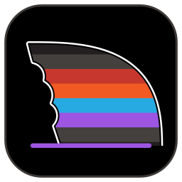
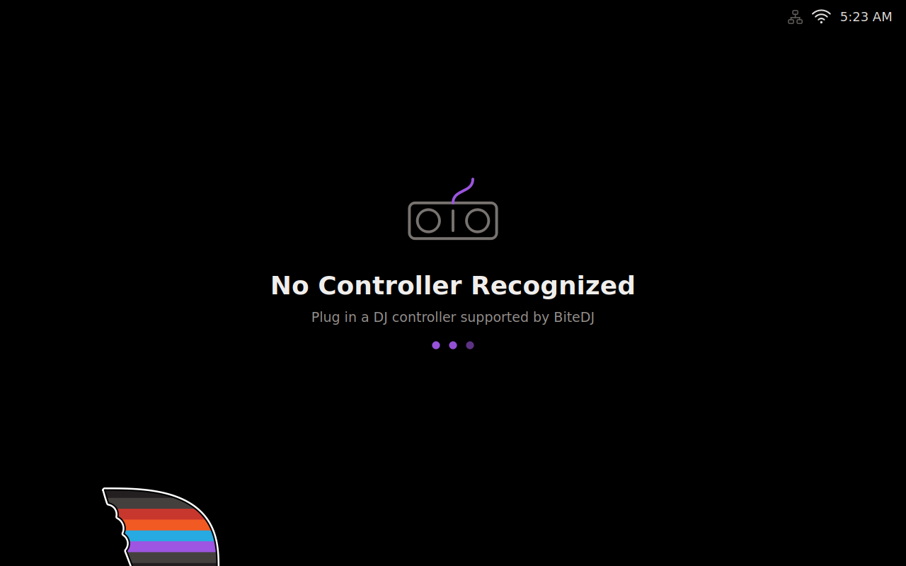
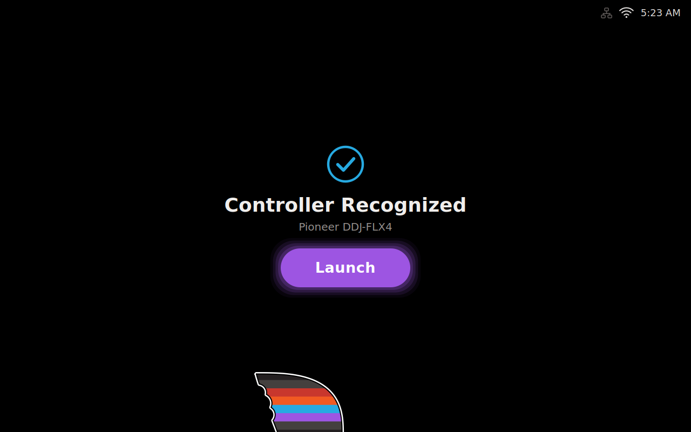
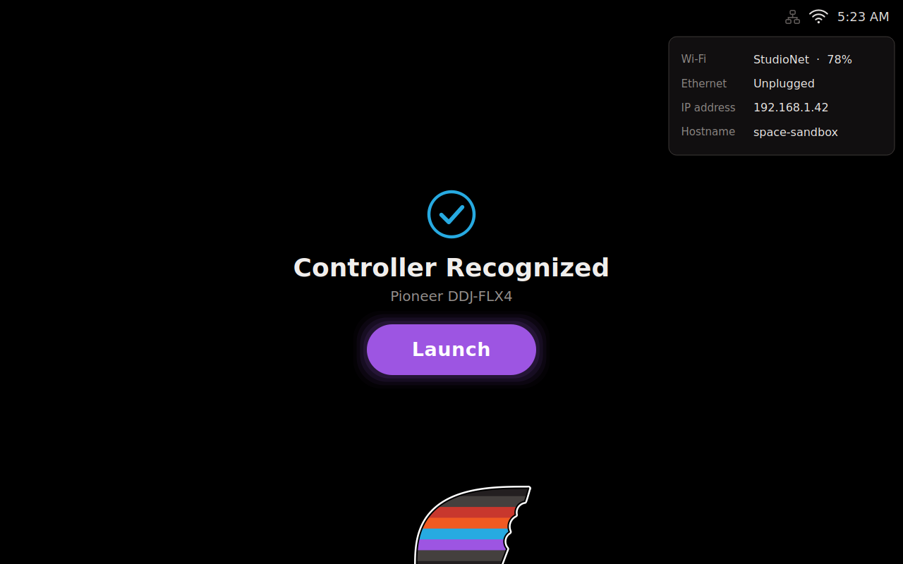
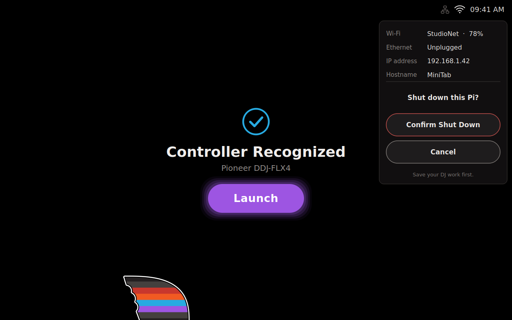
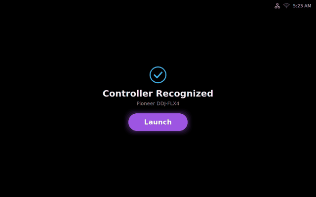

# Bite Launcher

Version **1.3.4**: the V3.2 launcher with bundled FLX4 controls, plus installer compatibility checks. The installer never changes boot settings: the Pi starts up exactly like stock Raspberry Pi OS.

<p align="center"></p>

## About

Bite Launcher is a touchscreen launcher for running **[BiteDJ](https://github.com/TeamDeckshark/bitedj) by [Team Deckshark](https://github.com/TeamDeckshark)** on a Raspberry Pi with a DJ controller such as the DDJ-FLX4. It's built around **Raspberry Pi OS** (Trixie, with the standard Raspberry Pi Desktop).

**Install BiteDJ first.** Bite Launcher doesn't install, build, or change BiteDJ. It only does two jobs:

- **Detection:** it watches for a plugged-in controller that BiteDJ supports, using the controller mappings that come with your BiteDJ install.
- **Launching:** when a supported controller is found, it shows a Launch button that starts BiteDJ full screen.

It also adds FLX4 hold macros, a status tray, and a switch to the Pi desktop.

BiteDJ is Team Deckshark's DJ software, based on [Mixxx](https://github.com/mixxxdj/mixxx) ([bitedj.com](https://bitedj.com)). This launcher is an unofficial community tool, not part of BiteDJ, and isn't affiliated with or endorsed by Deckshark. For BiteDJ support, contact its maintainers through the [BiteDJ repository](https://github.com/TeamDeckshark/bitedj).

## Screenshots

| Waiting for a controller | Controller recognized |
|---|---|
|  |  |
| **Tray: network and power** | **Power confirmation** |
|  |  |

<p align="center"><br>The animated fin in the corner of the launcher.</p>

## Quick start

1. **Set up the Pi.** Use [Raspberry Pi Imager](https://www.raspberrypi.com/software/) to install **Raspberry Pi OS with desktop** (Trixie). Boot it, connect to your network, and turn on SSH if you'll install remotely.
2. **Install BiteDJ.** Follow Team Deckshark's [BiteDJ repository](https://github.com/TeamDeckshark/bitedj). Check that BiteDJ starts on its own before going on.
3. **Point the launcher at BiteDJ, if needed.** By default, Launch runs `~/bitedj/build/mixxx`. If your BiteDJ is somewhere else, set `BITEDJ_APP=/path/to/bitedj` in `/etc/djrig.conf` after installing (`sudo nano /etc/djrig.conf`).
4. **Install Bite Launcher.** Run this as your normal user, not root:

   ```bash
   git clone https://github.com/ZoeroXD/Bite-Launcher.git ~/Bite-Launcher
   cd ~/Bite-Launcher
   bash ./install.sh --check-only   # read-only compatibility check
   bash ./install.sh
   ```

5. **Plug in your controller and reboot** (`sudo reboot`). The launcher opens and shows `Controller Recognized`. Tap **Launch** to start BiteDJ.

To see which controllers your BiteDJ install supports and what's plugged in:

```bash
python3 /opt/bitedj-launcher/bitedj_launcher.py --list-controllers
```

## Installation from Downloads

Save `BiteDJ-Launcher-1.3.4.zip` in the Pi's `/home/xdj/Downloads` folder. Use the newly delivered ZIP, not an older folder or V3.2 archive. Save and close your DJ work before installation and do not switch modes while installation is running.

If you download the ZIP on another computer, run these commands there, not inside the Pi SSH session. This example assumes that computer also saves downloads under `$HOME/Downloads`:

```bash
ssh xdj@MiniTab 'mkdir -p "/home/xdj/Downloads"' &&
scp "$HOME/Downloads/BiteDJ-Launcher-1.3.4.zip" \
  xdj@MiniTab:/home/xdj/Downloads/ &&
ssh xdj@MiniTab
```

If hostname resolution is unavailable, replace `MiniTab` with the Pi's known IP address. Do not rename an older ZIP to match the new filename.

Run as the normal user (`xdj`), not as root:

```bash
mkdir -p "$HOME/Bite-Launcher-1.3.4" &&
python3 -m zipfile -e \
  "$HOME/Downloads/BiteDJ-Launcher-1.3.4.zip" \
  "$HOME/Bite-Launcher-1.3.4" &&
cd "$HOME/Bite-Launcher-1.3.4/BiteDJ-Launcher" &&
bash ./install.sh &&
cat /opt/bitedj-launcher/VERSION
```

If you already extracted this release to `~/Downloads/BiteDJ-Launcher`, use:

```bash
cd "$HOME/Downloads/BiteDJ-Launcher" &&
if [ "$(cat VERSION)" = "1.3.4" ]; then
    bash ./install.sh &&
    cat /opt/bitedj-launcher/VERSION
else
    echo "Stop: this is not the 1.3.4 folder."
fi
```

The launcher installer checks compatibility before changing installed files or invoking apt. It targets Debian/Raspberry Pi OS Trixie with the Pi desktop components and labwc already installed; it does not install a desktop onto Lite or automatically repair an interrupted package database.

After a successful installation, the version must read `1.3.4`. Then reboot:

```bash
sudo reboot
```

If saved mode is desktop, the Pi intentionally returns to the desktop. Clicking Bite Launcher selects launcher mode for subsequent boots.

### Other installer options

```bash
bash ./install.sh --check-only
```

This inspects compatibility without installing.

## Preserved launcher behavior

- **No supported controller:** `No Controller Recognized`, the helper text `Plug in a DJ controller supported by Bite DJ.`, and no Launch button.
- **Supported controller:** `Controller Recognized`, controller name, and the existing purple Launch button.
- **Launch command:** `/home/xdj/bitedj/build/mixxx --fullScreen`. Do not start duplicate instances.
- **Original visual design:** unchanged fin geometry, bite marks, colors, outlines, slow movement, four-second pause, and default 30 FPS. Animation/network timers pause when BiteDJ is running and the launcher is inactive.
- **No process-based blanking:** detecting a BiteDJ process does not hide or blank the launcher. A fresh painted/exposed-window acknowledgement remains required before suppressing an existing desktop.
- **Tray:** live clock and network indicators; network details, Switch to Pi Desktop, Shut Down, and Reboot. Power actions require confirmation.
- **Exact normal-menu footer:** `Press “4 BEAT / EXIT” to disable launcher`.
- **Saved mode and singleton behavior:** one wrapper/app, persisted autostart choice, desktop shortcut creation at installation, and no shortcut-monitoring daemon.

| Control | Behavior |
|---|---|
| Desktop icon | Always enter launcher mode; enable autostart and reuse a running instance. |
| Ctrl+Alt+D | Two-way launcher/desktop mode toggle. |
| Clock hold, eight seconds | One-way desktop exit. Early release cancels. |
| Switch to Pi Desktop | One-way desktop exit. |
| Both decks' LOOP IN, three seconds | Directly start BiteDJ; no mode change. |
| Both decks' LOOP OUT, eight seconds | Stop BiteDJ only; no mode change. |
| Both decks' 4 BEAT/EXIT, eight seconds | Two-way mode toggle. |
| Shut Down / Reboot | Confirm, then request the system action; preserve saved mode. |

Desktop exit disables autostart, stops the wrapper first, closes BiteDJ if running, stops the launcher, restores the desktop, and saves desktop mode. Each completed controller hold triggers once; early release cancels.

The `~/.config/bite-launcher/autostart-off` marker still represents desktop mode. Standard Pi desktop autostart commands are guarded in launcher mode instead of being started and hidden afterward; failed launcher startup retains the existing desktop recovery behavior.

## Uninstall

From this release's extracted folder, run:

```bash
bash ./uninstall.sh
```

Uninstall checks for conflicts first and removes only the launcher's own files. Boot settings are not changed.

## Verification after installation

1. Confirm `/opt/bitedj-launcher/VERSION` reads `1.3.4`.
2. Test the waiting and recognized screens and the exact Launch command.
3. Test clock tap/hold, Ctrl+Alt+D, all three FLX4 holds, and the desktop shortcut.
4. Test saved ON and OFF mode across reboots.
5. Confirm power buttons display confirmation. Do not run a power action while DJ work is active.

Automated tests mock power requests and system changes.

Release validation: 61 automated tests passed. The headless Wayland probe passed waiting, recognized, existing-BiteDJ-process, and instance-reuse checks. Installed on MiniTab (Raspberry Pi 4, Trixie), where the FLX4 hold macros were confirmed working.

```bash
QT_QPA_PLATFORM=offscreen python3 -m unittest discover -s tests -v
python3 tests/wayland_smoke.py
```

The optional Wayland test requires Weston in the testing environment, not on the installed Pi.

## Image-build patch

The included `mixxxpi64-ng-bitedj-launcher.patch` is the preserved earlier image-build reference, not a verified 1.3.4 image-build release. Use the standalone Downloads installer above for this version.

## Credits

- **BiteDJ:** by [Team Deckshark](https://github.com/TeamDeckshark), in the [TeamDeckshark/bitedj](https://github.com/TeamDeckshark/bitedj) repository. BiteDJ is based on [Mixxx](https://github.com/mixxxdj/mixxx) and distributed under the GNU GPL v2.0.
- **Icons and artwork:** the Bite DJ name and logo, and the striped bite-mark design used in the launcher icon (`bite-launcher.png`) and the animated fin, are Deckshark's branding. Credit for those designs belongs to Team Deckshark. They're used here only to match the BiteDJ look.
- **Bite Launcher:** the launcher code, installer, and FLX4 macros are community-made by [ZoeroXD](https://github.com/ZoeroXD) for running BiteDJ on a Raspberry Pi.
